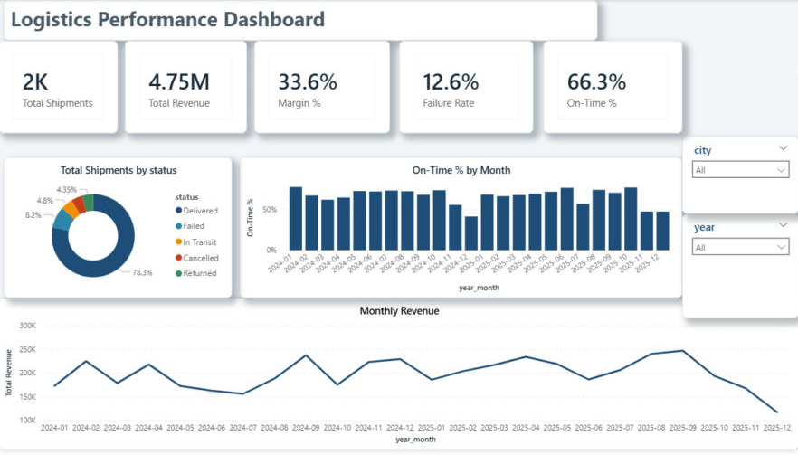
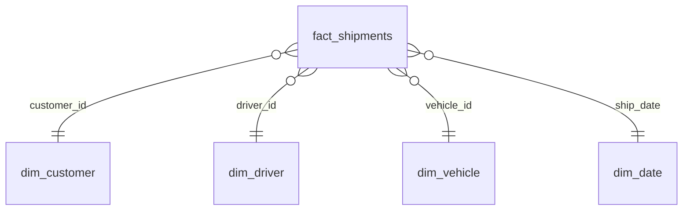
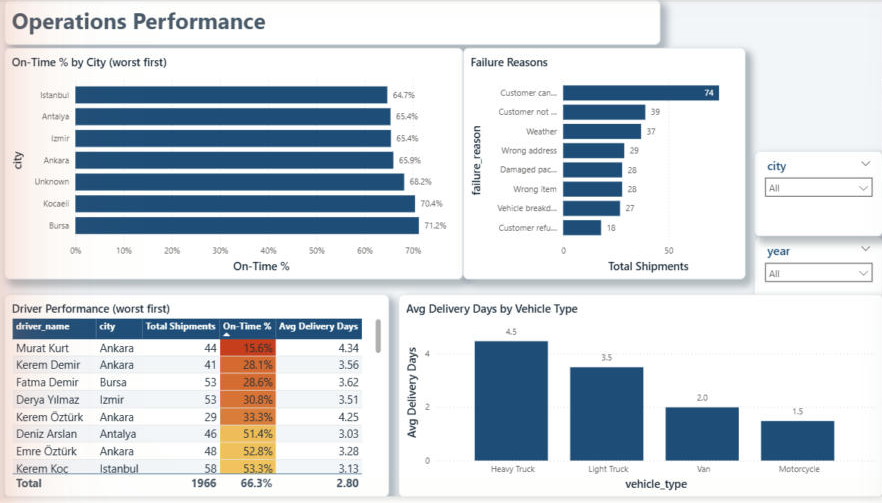
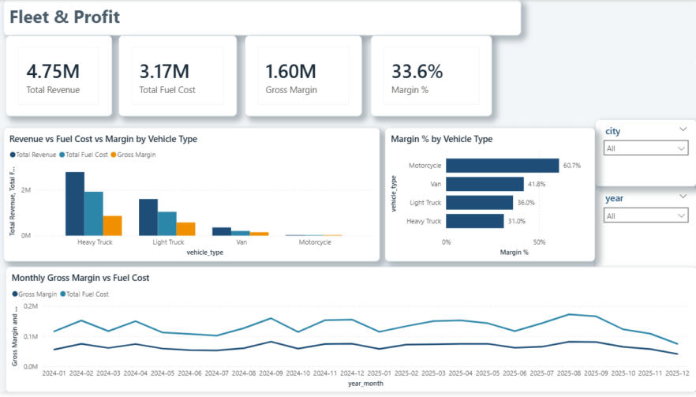

# Logistics Operations Analytics — SQL Server + Power BI

**[Open the live Power BI report](https://app.powerbi.com/view?r=eyJrIjoiMzczMGRiOTMtZGJhMy00ZDc2LTgyM2UtZWYwOGFmZGZlMmY4IiwidCI6IjM4N2Q0NmE2LWU4NWMtNDA4Ni1iYWVjLTY1YmU0NjIwNDczMiIsImMiOjl9)** (interactive, no sign-in needed)

End-to-end analytics project for a fictional Turkish delivery company: raw CSV files are loaded into SQL Server, profiled, cleaned, validated with keys and constraints, modelled as a star schema, and presented in a three-page Power BI dashboard.



## Business questions

1. What share of shipments are delivered on time, and how does it change over the year?
2. Which cities and which drivers drive late deliveries?
3. Why do shipments fail?
4. Which vehicle types make money, and how much of revenue goes to fuel?

## Tech stack

| Layer | Tool |
|---|---|
| Storage & transformation | SQL Server 2025 Express (T-SQL), SSMS |
| Data model | Star schema (`mart` schema: views + date dimension) |
| Reporting | Power BI Desktop, DAX, custom JSON theme |

## Architecture


Every script can be re-run safely (tables are dropped/truncated and rebuilt), so the whole pipeline runs from scratch in order `01 → 07`.

## Data

Synthetic dataset (2024-01 → 2025-12) with intentional data-quality problems:

| File | Rows (raw) | Problems planted |
|---|---|---|
| `customers.csv` | 208 | duplicates, 6 spellings of Istanbul (`IST`, `İstanbul`, `istanbul`…), blanks, mixed phone formats, 4 date formats |
| `drivers.csv` | 42 | duplicates, mixed date formats |
| `vehicles.csv` | 30 | inconsistent type names (`LightTruck`, `light truck`), `"1200 kg"` text in numeric column, comma decimals |
| `shipments.csv` | 2,025 | 25 duplicates, negative distances, `"45 km"` text, zero/blank prices, 5 status spellings, orphan customer/driver IDs, delivery dates before ship dates |

## Pipeline

| Script | What it does |
|---|---|
| [`01_create_database.sql`](sql/01_create_database.sql) | Database, `raw` / `clean` schemas, raw tables (all text so dirty rows never fail the load) |
| [`02_load_raw_data.sql`](sql/02_load_raw_data.sql) | `TRUNCATE` + `BULK INSERT` (UTF-8, CSV format) — idempotent load |
| [`03_profiling.sql`](sql/03_profiling.sql) | Finds the problems before fixing them |
| [`04_cleaning.sql`](sql/04_cleaning.sql) | `ROW_NUMBER()` de-duplication, `TRIM`/`UPPER`/`REPLACE` + `CASE` standardisation, multi-format date parsing with `COALESCE(TRY_CONVERT(...))`, numeric fixes, capacity imputation |
| [`05_relationships.sql`](sql/05_relationships.sql) | Anti-join integrity checks, **Unknown member** rows for orphan keys, impossible dates → NULL, primary & foreign keys |
| [`06_modeling.sql`](sql/06_modeling.sql) | Star schema: recursive-CTE date dimension, dimension views, fact view with `delivery_days`, `is_on_time`, `fuel_cost`, `gross_margin` |
| [`07_analysis.sql`](sql/07_analysis.sql) | Business questions with `RANK()`, running totals (`SUM() OVER`), `HAVING` |

### Star schema



### DAX measures

```dax
Total Shipments   = COUNTROWS(fact_shipments)
Total Revenue     = SUM(fact_shipments[price])
Total Fuel Cost   = SUM(fact_shipments[fuel_cost])
Gross Margin      = SUM(fact_shipments[gross_margin])
Margin %          = DIVIDE([Gross Margin], [Total Revenue])
On-Time %         = AVERAGE(fact_shipments[is_on_time])   -- 1/0/NULL flag built in SQL
Avg Delivery Days = AVERAGE(fact_shipments[delivery_days])
Failure Rate      = DIVIDE(CALCULATE([Total Shipments], fact_shipments[status] IN {"Failed","Returned"}), [Total Shipments])
```

## Dashboard

| Page | Purpose |
|---|---|
| **Executive Overview** | KPIs, status mix, on-time % by month, monthly revenue |
| **Operations** | On-time % by city, failure reasons, driver ranking with conditional formatting, delivery days by vehicle |
| **Fleet & Profit** | Revenue vs fuel cost vs margin by vehicle type, margin %, monthly margin trend |




## Key insights

- **Only 66% of delivered shipments arrive on time** — well below a typical 90% target — and performance drops every November–December (peak season).
- **Lateness is a driver problem more than a city problem.** Cities sit within ~6 points of each other (64.7%–71.2%), while the four worst drivers are below 31% on-time.
- **Almost half of failures are customer-side** (cancelled / not available / refused), pointing to pre-dispatch confirmation rather than fleet changes.
- **Heavy trucks bring ~58% of revenue at the lowest margin (31%)**; motorcycles have the best margin (61%) but negligible revenue. Fuel absorbs about two-thirds of revenue, so routing and right-sizing vehicles go straight to profit.
- December 2025 is a partial month (data ends on the 20th), so its dip is not a real decline.

## How to run

1. Copy `data/raw/*.csv` to `C:\logistics_data\` (or edit the paths in `02_load_raw_data.sql`).
2. In SSMS, run the scripts in `sql/` in order `01 → 07`.
3. Open `powerbi/logistics_dashboard.pbix`. If your server name differs, update it in **Transform data → Data source settings**.
4. Optional: apply `powerbi/logistics_theme.json` via **View → Themes → Browse for themes**.

## Author

**Lidiana Houro** — Information Systems & BI · [GitHub](https://github.com/lidianarhoro88)
